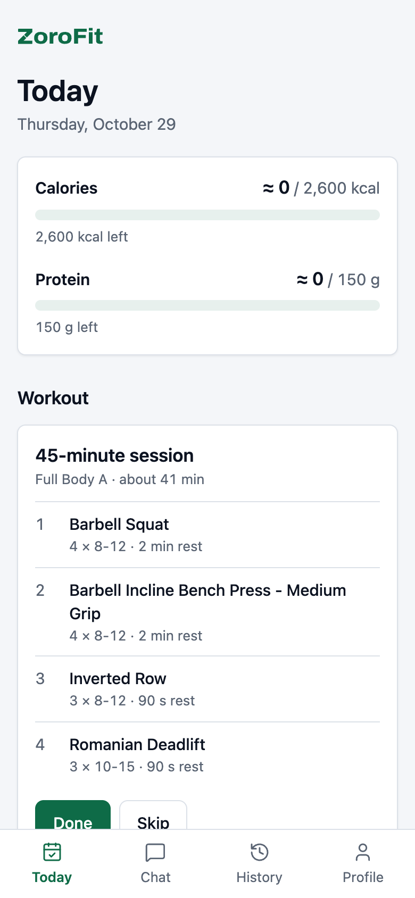
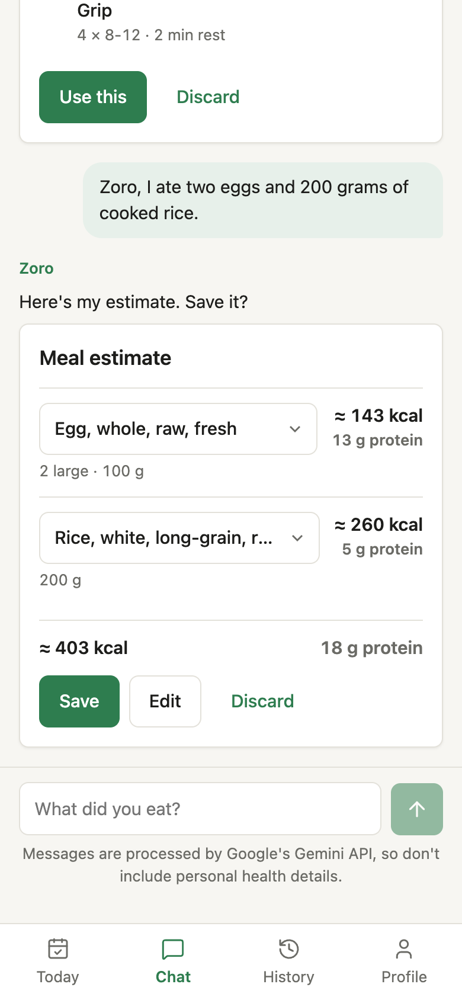
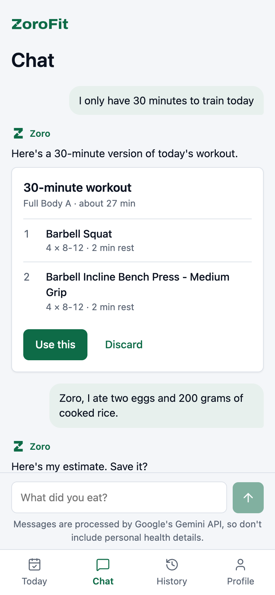
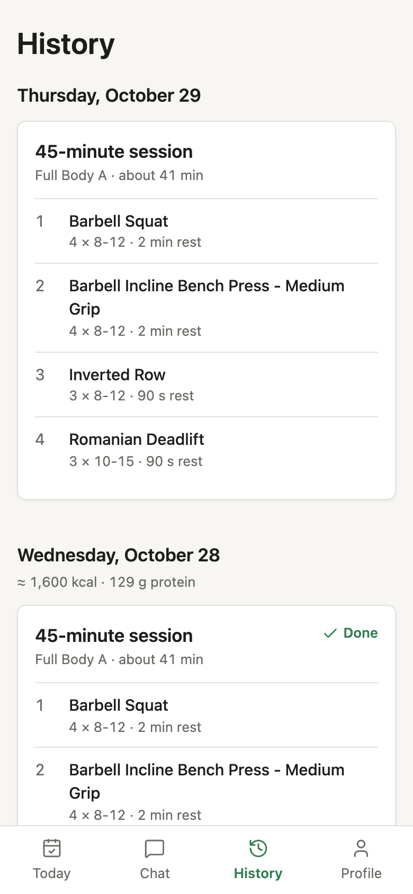
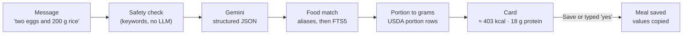

# ZoroFit

ZoroFit is a food log and workout planner that installs to a phone's home screen. You tell its assistant, Zoro, what you ate ("two eggs and 200 g of cooked rice") or how long you have to train, and it answers with a card you can check, edit, and save. The language model only reads your message; every calorie, gram, and set count comes from USDA data and plain Python.



## Screenshots

| Today | Chat: meal card | Chat: workout card | History |
| --- | --- | --- | --- |
|  |  |  |  |

## How a message becomes a meal



1. **Safety check.** Messages about injury, pain, illness, medication, pregnancy, or disordered eating get a fixed reply pointing to a professional. They never reach the model and never produce a workout.
2. **Interpretation.** Gemini returns JSON that matches a schema: a list of actions (`log_meal`, `confirm_pending`, `correct`, `plan_workout`, …) with food phrases, quantities, and units. Temperature is 0. If the JSON fails validation, it retries once.
3. **Food match.** Each phrase is checked against about 70 hand-picked aliases ("rice" → cooked white rice), then against a SQLite FTS5 index of about 7,800 USDA foods. Typos get a spelling fallback. When only some of the words match, the item is marked unmatched rather than guessed.
4. **Grams.** `portions.py` converts mass units directly, uses USDA portion rows for household units ("2 large", "1 cup", "3 slices"), and uses a food's volume portion to estimate density for ml. If nothing fits, the card asks how much and offers portion chips.
5. **Card.** Nothing is written until you confirm. Confirming is idempotent (a conditional `UPDATE … WHERE status = 'pending'`), so a double tap, or tapping Save and then typing "yes", saves one meal.

Workouts work the same way. The model only reports "30 minutes". Python fills a template with exercises your equipment allows, rotates choices by week, and trims the session to fit: lowest-priority exercises go first, then sets drop to a minimum of two.

## Decisions and tradeoffs

- **The model doesn't do math.** LLMs make arithmetic mistakes and invent portion sizes. Here the model only extracts what you said; lookups and multiplication happen in code that has tests.
- **USDA data is local.** Foundation Foods and SR Legacy are trimmed into two committed CSVs (about 1.4 MB) and built into a read-only SQLite file at startup. Search takes a few milliseconds, needs no API key, and keeps working when a free API changes its limits.
- **Confirm before save.** Food matching is sometimes wrong ("rice" could be dry or cooked). A card shows exactly what will be saved, every value can be edited, and a wrong match can be switched to another option.
- **No login.** Each browser gets a random device id in localStorage, sent as `X-Device-Id`. Every query is scoped by it. That keeps the demo one tap away, at the cost of data being tied to one browser.
- **Nutrition is copied on save.** Saved meals keep their numbers even if the food data is rebuilt later.

## Eval results

`backend/evals/meal_cases.jsonl` has 42 hand-written cases: single and multiple items, missing quantities, household units, typos, regional dishes, corrections, "yes" plus a new request, and out-of-scope messages. `python -m evals.run_meal_evals` calls the real model and scores intent, item count, food match, and quantity/unit accuracy. It writes a report to `backend/evals/results/`.

Both runs used `gemini-3.5-flash-lite` (free tier, temperature 0) and prompt `meal-v1`.

| Run | Intent | Item count | Food match | Quantity/unit | Typos: food match |
| --- | --- | --- | --- | --- | --- |
| [Baseline](backend/evals/results/2026-10-29-0025-gemini.md) | 100% (42/42) | 100% (34/34) | 85% (35/41) | 100% (47/47) | 40% (2/5) |
| [After fix](backend/evals/results/2026-10-29-0034-gemini.md) | 100% (42/42) | 100% (34/34) | 98% (40/41) | 100% (47/47) | 100% (5/5) |

**What the baseline showed.** The model read every message correctly: intents, items, quantities, and units were all right. Every miss was in food matching, and typos was the worst category. The spelling fallback found the right word ("brocoli" → "broccoli"), but then went straight to full-text search and skipped the hand-picked aliases, so it landed on raw broccoli instead of cooked. "Rize" scored a tie with "size", "ritz", and "ripe".

**What changed.** After spelling correction, search checks the aliases again, and a tie between close spellings goes to the word used in more food names. Two cases also expected food ids that had been replaced the day before; those expectations were corrected. One more miss ("almond" → almond butter) disappeared because the model wrote "almonds" the second time, so part of the gain is run-to-run variation, not the fix.

**What's left.** "Pho" still matches baking powder (its letters prefix "phosphate"). It's a dish USDA doesn't have, which is what My foods is for.

**Choosing the model.** `gemini-3.8-flash` took over a minute per reply on the free tier, and `gemini-3.5-flash` allows only 20 requests a day per project. `gemini-3.5-flash-lite` answered in about a second with the same accuracy on these cases, so it's the default.

## Known limitations

- USDA data is US-centric. Many home-cooked and regional dishes (biryani, pho, khichuri) are missing. Zoro says so and offers close matches, and you can add them under Profile → My foods.
- Without an account, data stays with one browser. Clearing site data starts a new, empty device.
- The free Render API sleeps after 15 minutes idle, so the first request can take up to a minute. The app shows a notice while it wakes.
- Bodyweight-only profiles have no pulling exercise. The workout card says which movement patterns were left out.
- The safety check is a keyword list. It errs on the side of refusing; for example, "my pain au chocolat" is refused.

## Run it locally

Backend (Python 3.12+):

```bash
cd backend
python -m venv .venv && source .venv/bin/activate
pip install -r requirements.txt
cp .env.example .env          # add GEMINI_API_KEY to use chat
uvicorn app.main:app --reload --env-file .env
```

Evals call the real model and read keys from the environment, so load `.env` first: `set -a; . ./.env; set +a; python -m evals.run_meal_evals`.

Startup runs the Alembic migrations and builds `data/foods.db` from the committed CSVs. Tests need no network or keys: `pytest`.

Frontend (Node 20.19+ or 22.12+):

```bash
cd frontend
cp .env.example .env
npm install
npm run dev
```

Open http://localhost:5173. Profile → Load demo data fills a week. Without an API key, chat falls back to the manual form.

To rebuild the food data, download the USDA "Foundation Foods" and "SR Legacy" CSV zips from https://fdc.nal.usda.gov/download-datasets, unzip them into `backend/data/raw/foundation/` and `backend/data/raw/sr_legacy/`, and run `python scripts/build_food_data.py`.

### Deploy

1. Create a Neon Postgres database and copy its connection string.
2. In Render, create a Blueprint from this repo (`render.yaml`). Set `DATABASE_URL` (the Neon string), `GEMINI_API_KEY`, and `FRONTEND_ORIGIN` (the static site's URL) on the API, and `VITE_API_URL` (the API's URL) on the static site.

## Data sources and credits

- U.S. Department of Agriculture, Agricultural Research Service. FoodData Central. fdc.nal.usda.gov.
- Exercises from [yuhonas/free-exercise-db](https://github.com/yuhonas/free-exercise-db) (public domain).

## Privacy

Chat messages are sent to the Gemini API free tier, which Google may use to improve its products. Don't enter personal health information.
